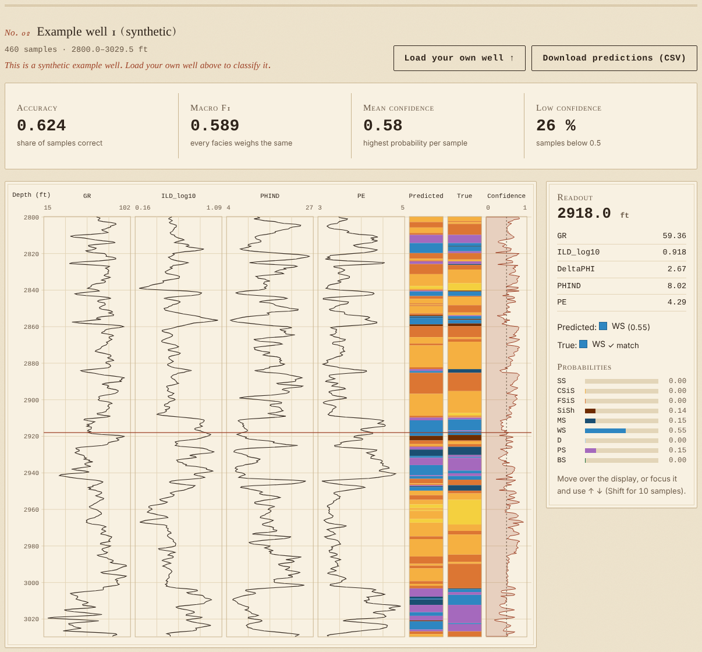

# Facies Classifier: Web Application

> **Status: beta.** The application works end to end, but predictions are indicative and the interface and API may still change.

**Live demo:** [facies-classifier-app.onrender.com](https://facies-classifier-app.onrender.com) (free hosting: the first load after a quiet period can take about a minute).

Web application that predicts nine lithofacies from the wireline logs of one well. A FastAPI service runs a neural network exported to ONNX, and the page shows the result as an interactive log display, with the confidence and probabilities of every depth sample and, when the true facies are given, the accuracy and macro F1.

The model comes from [Well-Log Facies Classification with a Neural Network](https://github.com/BoualemP/well-log-facies-classification), trained on the SEG 2016 machine learning contest dataset.



## Features

- Upload of a CSV file for one well, or two synthetic example wells.
- Log display: GR, ILD_log10, PHIND and PE curves, predicted and true facies columns and a confidence track, with a depth cursor (mouse or keyboard) and a readout of the logs and the nine probabilities.
- Scores (accuracy, macro F1), confidence summary and facies composition; predictions downloadable as CSV.
- Input checks with clear messages: missing columns (listing the columns found), empty or non-numeric values, several wells in one file, invalid codes. Column names are not case-sensitive, and a few aliases (DEPT, PEF) are recognised.
- An "About the model" section: training data, features, results, current limitations and next steps.
- Public JSON API with interactive documentation at `/docs`.

## API

| Endpoint | Returns |
|---|---|
| `POST /api/predict` | Facies, confidence and probabilities for an uploaded CSV |
| `GET /api/demo/{well}` | Prediction for a synthetic example well (`synthetic_a`, `synthetic_b`) |
| `GET /api/demo/{well}/csv` | The demonstration file, as an example of the expected format |
| `GET /api/health` | Service status |

## Model

| | |
|---|---|
| Inputs | GR, ILD_log10, DeltaPHI, PHIND, PE, NM_M, RELPOS, plus the gradient and 5-sample moving average of each log (17 features) |
| Network | Two hidden layers (64 and 32 units, dropout 0.3), Keras, exported to ONNX (15.5 kB) |
| Test wells (macro F1) | 0.446, against 0.399 for logistic regression and 0.396 for gradient boosting |

The feature steps of the notebook (capping, depth context, standardisation) are rebuilt in `app/core.py` from `settings.json`. With a local copy of the contest data (`FACIES_DATA=path/to/facies_vectors.csv pytest`), the tests check that the application reproduces the notebook's macro F1 on both test wells.

## Data

The SEG 2016 machine learning contest dataset is not openly licensed, so it is not included in this repository. The two example wells in `app/demo/` are synthetic: `scripts/make_demo_wells.py` simulates them from summary statistics of the training wells (facies transition frequencies, and the mean and covariance of the logs in each facies). Their `Facies` column holds the facies used in the simulation.

## Limitations and next steps

- Trained on five wells of one dataset: most reliable in rocks and logs similar to those wells.
- Needs NM_M and RELPOS, two interpretations specific to this dataset; a next model will use standard logs only and cope with a missing log such as PE.
- Rare facies are poorly recognised; more wells, other basins, depth-sequence models and class weighting are planned.
- CSV input with fixed column names; a column-matching step and LAS files are planned.

## Run locally

```
pip install -r requirements-dev.txt
pytest
uvicorn app.main:app --reload
```

Or with Docker:

```
docker build -t facies-classifier .
docker run -p 7860:7860 facies-classifier
```

## Tech stack

Python, FastAPI, ONNX Runtime, pandas, NumPy, pytest, HTML, CSS, JavaScript (SVG), Docker, GitHub Actions.

## Project structure

```
facies-classifier-app/
├── app/
│   ├── core.py          # input checks, features, prediction, scores
│   ├── main.py          # API and page
│   ├── model/           # facies_model.onnx, settings.json
│   └── demo/            # two synthetic example wells
├── static/              # index.html, style.css, app.js
├── scripts/             # make_demo_wells.py
├── tests/
├── docs/screenshot.png
├── Dockerfile
├── requirements.txt
├── requirements-dev.txt
└── LICENSE
```

## Licence

Code under the [MIT licence](LICENSE). © 2026 Boualem Pereira.

## Author

**Boualem Pereira**
